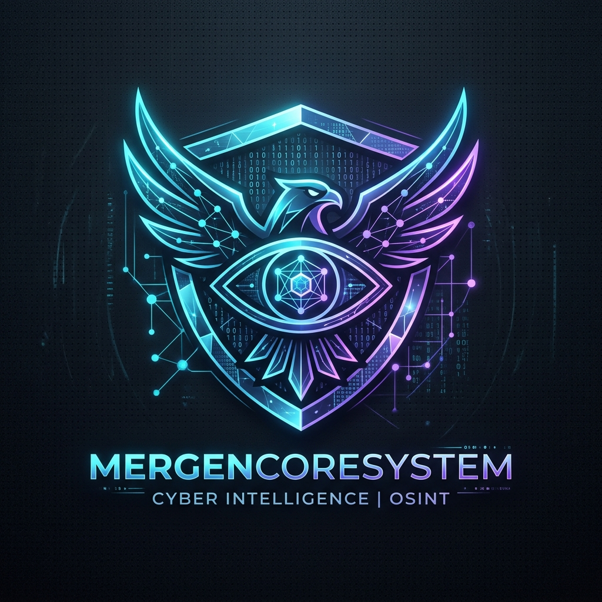

<div align="center">



# MergenCoreSystem
### Next-Generation Cyber Intelligence & OSINT Framework

[](https://www.python.org/)
[](https://www.kali.org/)
[](LICENSE)
[](#)

*MergenCoreSystem, dijital istihbarat, hedef deanonimizasyonu, ağ keşfi ve zafiyet analizi için geliştirilmiş kapsamlı ve modüler bir OSINT (Open Source Intelligence) platformudur.*

</div>

---

## ⚡ Temel Özellikler & Modüller

| Modül | Açıklama |
|---|---|
| 🌐 **Domain & DNS Analitiği** | DNS haritalandırma, CMS tespiti, alt alan adı (subdomain) keşfi, HTTP header analizi ve sayfa link çıkartıcı |
| 📍 **Geolocation & Big Brother** | Sosyal mühendislik ve sahte landing sayfaları üzerinden hedef konum belirleme |
| 📱 **Telefon Numarası Doğrulama** | Numverify API entegrasyonu ile uluslararası numara formatı, operatör ve taşıyıcı analizi |
| 🔎 **IoT & Cihaz Keşfi (Shodan)** | Shodan arama motoru entegrasyonu ile açık port ve servis taraması |
| 🖼️ **Ters Görsel Arama** | Çoklu arama motorları üzerinden görüntü eşleştirme ve görsel istihbaratı |
| 📄 **Metadata Çıkarıcı** | Fotoğraf (EXIF) ve PDF dosyalarından gömülü meta verileri, GPS koordinatlarını çözümleme |
| 🤖 **Android Debug Bridge (ADB)** | Ağ üzerinden bağlı Android cihazları tespit, inceleme ve yönetim komut seti |
| 👤 **Kullanıcı Adı Taraması** | Çoklu platformlar ve sosyal ağlar üzerinde takma ad / username ayak izi takibi |
| 📚 **İstihbarat Bilgi Bankası** | Bölgesel ve küresel OSINT kaynaklarını içeren 49 kategorilik geniş kütüphane |

---

## 🚀 Kurulum

### 1. Depoyu Klonlayın
```bash
git clone https://github.com/MergenCoreSystem/MergenCoreSystem.git
cd MergenCoreSystem
```

### 2. Bağımlılıkları Yükleyin
```bash
# Python paketlerini yükleyin
pip3 install -r requirements.txt
```

### 3. Sistem Gereksinimleri
En iyi performans ve tam uyumluluk için **Kali Linux** veya **Parrot OS** önerilir:
- Python 3.8+
- PHP (Geolocation yerel sunucu için)
- ADB (Android cihaz modülü için: `sudo apt install adb`)

---

## 🔑 API Yapılandırması

İlgili harici servislerden maksimum verim almak için `mergencore.py` dosyasındaki `api` sözlüğüne kendi anahtarlarınızı ekleyebilirsiniz:

```python
api = {
    "Shodan": "SHODAN_API_KEY",
    "Gmap_g": "GOOGLE_MAPS_KEY",
    "IP_api": "IP_API_KEY",
    "ngrok.set_auth_token": "NGROK_TOKEN",
    "virustotal_api": "VIRUSTOTAL_KEY",
    "cms_detect_api": "WHATCMS_KEY",
    "phone_apis": "NUMVERIFY_KEY"
}
```

---

## 🖥️ Kullanım

Platformu başlatmak için:

```bash
python3 mergencore.py
```

Açılan interaktif terminal menüsünden dilediğiniz modülü numarasını girerek çalıştırabilirsiniz:
- `99` → Bir önceki / ana menüye dön
- `66` → Ekranı temizle
- `00` / `0` → Çıkış

---

## ⚖️ Yasal Uyarı

Bu araç yalnızca **yasal güvenlik testleri, açık kaynak araştırmaları, siber savunma ve eğitim amaçlı** geliştirilmiştir. Aracın izinsiz veya kötü niyetli kullanımından doğabilecek her türlü hukuki ve cezai sorumluluk tamamen kullanıcıya aittir. Geliştiriciler sorumluluk kabul etmez.

---

## 📄 Lisans

Bu proje [MIT Lisansı](LICENSE) kapsamında lisanslanmıştır.
